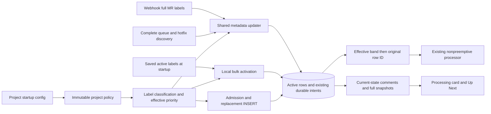

# Три уровня приоритета MR

План первой версии для merge queue

18 октября 2026 года

**Статус — предлагаемый план, реализация ещё не начата**

очередь должна выбирать сначала hotfix, потом ordinary, потом automated. внутри каждого уровня остаётся порядок исходной постановки. MR, который уже обрабатывается, заканчивает свой workflow, даже если в это время пришёл более приоритетный

ниже собран один рекомендуемый вариант v1. бизнес-правила отдельно отмечены как согласованные пользователем. представление данных, валидация, API и технические шаги — рекомендации этого плана, а не дополнительные уже утверждённые требования

Точка сравнения — merged `origin/main` на `c6b93dfd1e85d3dafa46f0dfd06ffa5da62b4dc3`. Его дерево совпадает с исследованным workspace `447d115781b94f67771ebca296b577688b77d0fb`. В плановой фазе не запускались тесты, миграции, БД, UI, benchmarks или EXPLAIN. Все проверки и численные бюджеты ниже относятся к будущей реализации

Документ следует двенадцати разделам retained System Design reference. Это самостоятельный Markdown-план, для его использования не нужны промежуточные заметки или файлы из `/tmp`

## 1 Abstract

автоматизированный MR определяется по меткам своего проекта. достаточно совпадения любой метки со списком `automation_labels`. автор, username, слово Renovate в заголовке и GitLab bot flag в классификации не участвуют

Для v1 рекомендуется сохранить существующий `is_hotfix`, добавить `is_automated` только в активную таблицу и вычислять effective priority из этих двух фактов. Hotfix всегда выигрывает, даже если его метка сама входит в automation list. Сортировка в raw SQL, ORM и позициях одна — effective band, затем исходный `merge_requests.id`

Automation не становится новым admission trigger. MR всё ещё должен иметь существующую queue или hotfix метку. Если имя automation label совпало с одним из triggers, admission происходит именно по прежнему trigger, а не по новому правилу

Изменения labels применяются к существующей строке через общий metadata updater. Webhook, polling, startup и replacement после completion должны использовать одну project policy. Локальная переклассификация заканчивается до запуска traffic и задач, а remote refresh остаётся отдельным процессом. Недоступный GitLab не позволяет обещать свежесть ещё не полученных labels

В active REST и всех полных WebSocket snapshots добавляется `priority = hotfix | ordinary | automated`. Dashboard показывает серверный порядок и отдельную карточку уже работающего MR. History и frozen `pending_completion.history` в v1 не расширяются

## 2 Goals and Non-Goals

### Согласованные правила

| Правило | Что это означает на практике |
| --- | --- |
| Hotfix > ordinary > automated | Более низкий уровень выбирается только после ожидающих более высоких |
| FIFO внутри effective band | Ключ — исходный queue row ID, не IID, timestamp или время смены метки |
| Нет preemption | Уже выполняемый rebase/test/merge продолжается |
| Список меток на проект | Совпадение любой метки достаточно, автор не влияет |
| Пустой список сохраняет прежнее поведение | Нет нового automated band, hotfix и ordinary работают как раньше |
| Automation label сама не ставит MR в очередь | Admission по queue/hotfix labels остаётся прежним |
| Relabel меняет существующий entry | Не создаёт новую строку и не меняет время постановки |
| Все пути согласованы | Webhook, poll, startup и восстановление после restart сходятся к одной классификации |
| Конфигурация читается при запуске | UI editor и hot reload в первой версии не нужны |
| Strict priority | Непрерывный поток ordinary/hotfix может надолго задерживать automated |

### Что входит в рекомендуемый v1

Новый active-флаг, один resolver effective priority, project policy, единый порядок raw/ORM/positions, relabel и startup bulk reconciliation, durable feedback, active REST/WS contract, небольшое изменение Dashboard, новая миграция после a7 и проверяемый rollout/rollback

Необходимая correctness предпосылка — полный обход страниц queue/hotfix discovery. Текущий one-page limit может скрыть часть eligible MR и сделать reconciliation разрушительным. Исправление ограничивается этим fetch contract и его consumers

### Что остаётся вне v1

Нет aging, квот и обещания максимального ожидания automated. Нет классификации по автору, ручного drag-and-drop, отдельной очереди для ботов, нового брокера, distributed exactly-once или новой processing claim модели

История не получает новый priority snapshot. Не переписываются старые retry/DLQ payloads, source-time uncertainty, receipt/provenance правила и frozen archive migrations. Общий cache/transport refactor, обязательная virtualization и переделка всех frontend connection states не являются prerequisites

## 3 Background and Problem Statement

сейчас runtime QueueManager сортирует `is_hotfix DESC, id ASC`. ORM repository использует `queued_at` и отдельно считает position. Для нового согласованного FIFO нужно привести затронутые raw и ORM paths к одному ключу, иначе processor, API и уведомления могут рассказывать о разных очередях

Общими являются Database и QueueManager. GitLab client, processor, scheduler и notifier создаются по проектам. Поэтому policy должна быть доступна общему QueueManager по `project_id`, в том числе при прямом replacement INSERT из durable request. «Текущий проект» в mutable global state или fallback к первому проекту здесь недопустимы

Существующий lifecycle уже защищает metadata revision, queue incarnation, notification token, completion ownership и requeue receipts. Новая классификация должна расширить эти границы, а не создавать параллельный updater или второй outbox

Dashboard живёт от `useWebSocket`, а не от initial REST queue fetch. Добавить поле только в REST недостаточно. В raw active list работающий ordinary/automated MR может идти после ожидающего hotfix. UI уже выделяет processing отдельно и сохраняет порядок queued subsequence — это правильная основа для non-preemption

### Основные точки текущего кода

| Область | Исходники и причина изменения |
| --- | --- |
| Project config | [config.py](../../backend/src/gitlab_queue/config.py), [project_components.py](../../backend/src/gitlab_queue/core/project_components.py) — strict parser, immutable project settings |
| Storage и порядок | [queue.py](../../backend/src/gitlab_queue/core/queue.py), [repositories.py](../../backend/src/gitlab_queue/db/repositories.py), [models.py](../../backend/src/gitlab_queue/db/models.py), [queue_item.py](../../backend/src/gitlab_queue/models/queue_item.py) |
| Reconciliation | [queue_metadata.py](../../backend/src/gitlab_queue/core/queue_metadata.py), [handlers.py](../../backend/src/gitlab_queue/webhooks/handlers.py), [scheduler.py](../../backend/src/gitlab_queue/core/scheduler.py), [processor.py](../../backend/src/gitlab_queue/core/processor.py) |
| Startup и generations | [main.py](../../backend/src/gitlab_queue/main.py), [queue_completion.py](../../backend/src/gitlab_queue/core/queue_completion.py), direct completion/replacement paths в QueueManager |
| Delivery и snapshots | [notifier.py](../../backend/src/gitlab_queue/core/notifier.py), [queue_position_notifier.py](../../backend/src/gitlab_queue/core/queue_position_notifier.py), [router.py](../../backend/src/gitlab_queue/webhooks/router.py), [websocket.py](../../backend/src/gitlab_queue/api/websocket.py) |
| GitLab discovery | [gitlab.py](../../backend/src/gitlab_queue/clients/gitlab.py) — `list_mrs_with_label`, completeness существующего pagination helper |
| Dashboard | [App.tsx](../../frontend/src/App.tsx), [Dashboard.tsx](../../frontend/src/pages/Dashboard.tsx), [useWebSocket.ts](../../frontend/src/hooks/useWebSocket.ts), [types.ts](../../frontend/src/types.ts) |
| Миграционные границы | [migrations.py](../../backend/src/gitlab_queue/db/migrations.py), [env.py](../../backend/migrations/env.py), [database.py](../../backend/src/gitlab_queue/db/database.py), [a7](../../backend/migrations/versions/a7b8c9d0e1f2_fix_timestamp_defaults.py), [retry_archive_v1.py](../../backend/migrations/retry_archive_v1.py) |

Это карта ответственности, а не перечень обязательных рефакторингов. Номера строк не фиксируются как часть будущего контракта

## 4 Proposed Architecture

### Один классификатор и прежний lifecycle



Project policy создаётся один раз из валидированного config. Для repeated membership достаточно `frozenset` имён, при этом исходное значение остаётся immutable tuple. Classifier не делает HTTP, не читает часы и не получает автора. Отдельный pure resolver переводит два stored facts в effective enum. Python helper и SQL CASE имеют одну таблицу истинности, проверяемую независимыми examples

QueueManager получает immutable `project_id → policy` mapping при создании приложения. Все новые inserts и replacement используют его. Неизвестный проект не получает пустую или чужую policy автоматически — его данные сохраняются, runtime применяет существующую обработку unconfigured project и выдаёт понятную диагностику

| Компонент | Ответственность | Граница |
| --- | --- | --- |
| Config/policy | Проверка project settings и membership set | До traffic и DB backfill |
| Classifier/resolver | Два факта и один effective band | Без I/O и mutable rank |
| QueueManager/repository | Inserts, CASE/id order, position, CAS, atomic intents | Короткие DB transactions |
| Metadata updater | Общий authoritative refresh | Существующие project/MR coordination и revision protection |
| Startup bulk | Локально применить новую policy к известным active rows | До конкурирующих runtime tasks |
| Completion/requeue | Сохранить исходный outcome, классифицировать новую incarnation | По final merged labels и текущей policy |
| Notifier/API/WS | Показать уже зафиксированную effective truth | Pending tokens и current-state reads |
| Frontend | Показать server order, отдельный running MR и badge | Без своего classifier или sort |

### Какой порядок считается каноническим

```sql
ORDER BY
  CASE
    WHEN is_hotfix = 1 THEN 0
    WHEN is_automated = 1 THEN 2
    ELSE 1
  END ASC,
  id ASC
```

Оба flags могут быть true, это всё равно один hotfix band. Запись `is_hotfix DESC, is_automated ASC` запрещена как реализация этого контракта — она разбивает hotfix и меняет FIFO

Порядок применяется в active list, next queued selection, before/after snapshots уведомлений и ORM position predicate. Position сравнивает `(effective rank, id)` внутри проекта. `queued_at` нужен для времени ожидания, но не является tie-breaker. Реальный remove/rejoin создаёт новую incarnation с новым ID, relabel и config restart — нет

## 5 Request Lifecycle

### Startup и изменение policy

1. Проверить весь config и собрать все immutable policies
2. Применить новую revision существующим migration gate
3. Создать общий QueueManager с policy lookup
4. По каждому configured project выполнить local activation из persisted active labels
5. Завершить общий local barrier до webhook intake, retry processor, scheduler, completion recovery и первого selection
6. Запустить существующее recovery и remote sync. HTTP failures оставляют существующий degraded режим и повторяемые intents

Локальная activation пересчитывает **только новый automation fact**, сохраняя известный `is_hotfix`. Даже nullable/неполные persisted labels не должны снять уже известный hotfix. NULL/invalid saved labels дают conservative automation false до authoritative refresh, исходный raw JSON не переписывается, unknown snapshot считается и логируется

Authoritative полный webhook/poll/startup HTTP snapshot пересчитывает оба facts по текущим labels проекта. Missing/invalid remote labels и failed fetch не являются пустым списком. Так отделяется доступная локальная классификация от ещё неизвестных изменений GitLab

Для каждого проекта bulk берёт один initial order и один final order. Меняются только отличающиеся metadata, staging происходит один раз на affected queued MR по итоговому порядку. HTTP delivery после commit, initial consumers получают итоговый snapshot. При crash между проектами следующий startup повторяет идемпотентный проход. DB failure не считается завершённым barrier, ни один task не начинает работать на частично установленной policy

Первая реализация — одна transaction на проект в поддерживаемом размере очереди. Chunking вводится только если замеры показывают долгий write lock, при сохранении общего startup barrier. Local pass не меняет state, started_at, pipeline, SHA, attempts или queued_at. Существующее восстановление interrupted workflow остаётся отдельным шагом

### Admission, relabel и удаление triggers

Новый MR сначала проходит прежний predicate queue/hotfix. После полного MR fetch labels классифицируются и вставляются с обоими flags. Только automation label у absent MR не создаёт row, initial comment или workflow

У существующего active MR automation-only `labeled`, `unlabeled` и `update` должны доходить до общего updater. Это закрывает нынешний early-return для сторонней добавленной метки. Labels, оба facts и metadata revision обновляются атомарно на той же строке. Removing last automation label переводит automated в ordinary, если admission trigger остаётся. Removing last queue/hotfix trigger удаляет MR по прежним правилам, automation не удерживает membership

Изменение automation bit под hotfix обновляет metadata, но effective band и hotfix FIFO прежние. Нужен fresh metadata snapshot, но не ложный priority-change comment или reorder fanout. Идентичный replay не увеличивает revision и не создаёт новую обратную связь. Старый pending feedback всё равно можно drain

### Polling и полнота discovery

Discovery остаётся union queue/hotfix, без list call на каждый automation label. `list_mrs_with_label` должен получить полный набор страниц. Рекомендуется узкий strict completeness mode или dedicated complete helper, не молчаливая смена поведения всех pipeline/job callers

Safety cap остаётся защитой, но page failure, invalid/non-advancing next-page и достижение cap с продолжением делают **весь authoritative discovery неполным**. Такой sweep не выполняет orphan removal, cleanup или reclassification на основании частичного набора. Existing independent pending delivery может продолжаться. Успешный следующий poll снова приводит очередь к remote truth

Для двух списков нужен полный snapshot каждого. Dedup по project/IID должен учитывать более поздний полученный full snapshot и revision protection, не удерживать заведомо старую первую копию и не объединять remote labels из разных моментов в искусственный union. Это отдельный случай от существующего source-uncertainty merge durable requeue

### Processing и конкретные очереди

MR1 ordinary уже testing. MR2 ordinary и MR3 automated ждут. Пока MR1 удержан реальным HTTP barrier, последовательно приходят HF1, automated MR4, ordinary MR5, HF2

```text
ожидающие после всех arrivals    HF1 → HF2 → MR2 → MR5 → MR3 → MR4
фактическое исполнение           MR1 → HF1 → HF2 → MR2 → MR5 → MR3 → MR4
```

Если MR1 сам automated, правило то же — он заканчивает первым. Если HF2 появляется лишь после фактического старта MR2, MR2 тоже не прерывается. Порядок относится к зафиксированной очереди при очередном выборе, новая distributed atomic claim модель здесь не обещается

Другой пример показывает original FIFO. Вставлены `A7, O2, A9, H4`, где буква означает класс, цифра — IID. Порядок `[4,2,7,9]`. Снятие automation label у старого MR7 даёт `[4,7,2,9]`, потому что его исходный row ID меньше ID MR2. Никакого нового promotion timestamp нет

### Completion, old payload и replacement

Frozen completion outcome/history не переклассифицируются новой policy. Старые `pending_completion.history` и `pending_notification` остаются читаемыми без global JSON rewrite

Replacement — новая постановка. Прямо перед его INSERT classifier использует **final merged labels и текущую policy проекта**, даже если durable request записан до upgrade или restart и нового поля в нём нет. Нельзя подставить false и забыть label classification

Automation-only relabel при уже admitted future request обновляет его classification-относящиеся labels через существующее source-order/CAS ownership. Само событие не создаёт requeue, не оживляет cancelled request и не меняет timestamps, precision, token, receipts или cleanup UUID. В uncertainty merge automation вычисляется после принятого итогового label merge. Старое поколение не может ACK/delete новое. Cleanup снимает только прежние queue/hotfix triggers, отдельные automation labels сохраняет

## 6 API and Data Contracts

### Рекомендуемая project config

Поле добавляется в каждый объект существующего `GITLAB_QUEUE_PROJECTS`. Отсутствие и `[]` дают `()`. Отдельный global automation env в v1 не добавляется. Legacy single-project env остаются рабочими с пустым списком, а включение automation для одного проекта использует one-entry JSON

```json
[
  {
    "project_id": 123,
    "token": "example-token-not-a-secret",
    "queue_label": "merge_queue",
    "hotfix_label": "hotfix",
    "automation_labels": ["dependencies", "renovate"]
  },
  {
    "project_id": 456,
    "token": "another-example-token",
    "automation_labels": []
  }
]
```

Это пример значения env, не предложение хранить реальные tokens в документе или новом файле. Остальные существующие project defaults сохраняются

Следующая validation policy — проектная рекомендация v1. Она проверяется и через Settings parser, и при direct ProjectConfig construction

| Вход | Рекомендуемый результат |
| --- | --- |
| Нет поля, `[]` | Пустая immutable collection |
| `null`, string, number, boolean, object вместо array | Ошибка до DB mutation/HTTP |
| Не-string member, empty/blank-only name | Ошибка с project ID и именем поля, без token |
| Leading/trailing whitespace | Ошибка, без скрытого trim |
| Внутренние пробелы и Unicode | Сохраняются как часть имени |
| Точный duplicate | Ошибка, без тихой дедупликации |
| `renovate` и `Renovate` | Разные допустимые имена |
| Имя совпало с hotfix_label | Разрешено, effective hotfix остаётся первым |
| Имя совпало с queue_label | Разрешено, все queue-admitted nonhotfix станут automated по этой policy |
| Одинаковое имя в двух проектах | Разрешено, каждый использует свой список |
| Unknown field и invalid/duplicate project ID | Прежняя строгая проверка сохраняется |

Membership — exact string equality. Без lowercase, Unicode normalization, substring matching и author heuristic. Старые queue/hotfix значения попутно не нормализуются. Configured overlap и наличие двух разных labels на одном MR — разные допустимые случаи. Optional startup warning о queue-label overlap может объяснить массовую классификацию, но не запрещает config и не требует UI editor

### Decision table

Q означает существующий queue trigger, H — hotfix trigger, A — совпадение с automation list. Таблица полная для различающихся имён, configured overlap лишь делает некоторые комбинации недостижимыми

| Q | H | A | Admission и effective priority |
| --- | --- | --- | --- |
| нет | нет | нет | Нет admission |
| нет | нет | да | Нет admission |
| да | нет | нет | Ordinary |
| да | нет | да | Automated |
| нет | да | нет | Hotfix |
| нет | да | да | Hotfix |
| да | да | нет | Hotfix |
| да | да | да | Hotfix |

Несколько matching automation labels не создают несколько entries или уровней. При удалении одной из двух matching labels MR остаётся automated. Human-authored MR может быть automated, bot-authored — ordinary

Configured overlap проверяется отдельными literal cases. При `automation_labels=[H]` и MR labels `[H]` возникает ровно один admitted hotfix с обоими facts true. При `automation_labels=[Q]` и labels `[Q]` возникает ровно один admitted automated. При `automation_labels=[A]` и labels `[A]`, где A отличается от обоих triggers, admission нет. MR с разными `[H,A]` тоже один hotfix, это другой случай, чем alias одного имени

### Active storage и wire format

| Данные | Контракт v1 |
| --- | --- |
| `merge_requests.is_automated` | Integer/bool 0/1, NOT NULL, default false, только active storage |
| `is_hotfix` | Прежнее поле и смысл сохраняются |
| `priority` | Вычисленный enum `hotfix`, `ordinary`, `automated`, не третья mutable DB truth |
| `labels`, `metadata_version` | Один атомарный snapshot с обоими facts |
| Identity | project/IID и уникальный queue row ID, без переиспользования incarnation |
| `pending_notification` | Existing token/status/old_position, актуальный class читается при delivery |
| Completion history | Прежняя schema и frozen dict, без нового required bind |
| Requeue params | Старый missing flag допустим, final labels/current policy определяют новую запись |

Новый backend всегда возвращает effective `priority` для active REST list/detail и **каждого** initial/full `queue:updated` snapshot — helper, webhook, scheduler и processor producers. `is_hotfix` сохраняется для старых клиентов. Raw `is_automated` публиковать не нужно

Status delta не стирает уже полученный priority. Relabel публикуется полным snapshot с согласованными labels, class и order, отдельного client reorder event нет. Stats по status не становятся priority counters. History REST/DTO и экран History не меняются

FastAPI queue routes сейчас используют generic dict. Поэтому implementation slice добавляет минимальное явное описание затронутого response и enum в OpenAPI, сохраняя существующие envelope/имена. WebSocket contract описывается отдельно. Несвязанные старые state/status naming расхождения не чинятся заодно. Additive поле не требует API version bump

Новый frontend принимает optional `priority`. Recognized enum имеет приоритет. Missing/null/unknown runtime значение даёт legacy fallback `is_hotfix ? hotfix : ordinary`, не Automated по догадке. Старый frontend игнорирует additive поле. Legacy fixtures без priority обязательно остаются

### Dashboard первой версии

Одна небольшая shared `PriorityBadge` используется в processing card и Up Next. Hotfix сохраняет orange treatment и текст `Hotfix`. Automated получает нейтральный читаемый badge `Automated`, ordinary — без visible badge. StatusBadge и stepper не меняются. При обоих facts показывается один Hotfix badge, raw labels остаются видны отдельно

```text
Processing now
!90 Update dependencies     Testing    Automated
by Alice                   Duration 04:18
The running MR continues before waiting MRs start

Up Next (5)
Positions are among waiting MRs
Hotfix → Ordinary → Automated

#1 !102 Fix timeout          Hotfix
#2 !101 Add export option
#3 !110 Correct help text    by Renovate
#4 !80  Bump library         Automated   by Alice
#5 !91  Update toolchain     Automated
```

Это wireframe, не screenshot. Product copy следует существующему английскому UI, перевод приложения не входит в задачу. Общая видимая подпись объясняет non-preemption и FIFO, supplementary native title не является единственным источником смысла

Up Next — queued subsequence серверного массива, без client sort. `#1` означает первого ожидающего, номера непрерывны между bands. Existing payload `position` — rank **всего active list**, включая processing. Это разные величины. API/comment semantics не подменяются ради UI-нумерации

Смена class у active MR меняет только badge/metadata. Не меняются его key, status, duration, started_at и progress. Active automated остаётся сверху как processing, даже если raw active array начинается с waiting hotfix

Минимальный UI guard относится к новым acceptance cases. Queued-only snapshot не должен говорить `Queue is empty`. Socket connected до первого full snapshot не доказывает пустую или актуальную очередь. После disconnect/reconnect последнее известное расположение можно сохранять, но оно помечается как last received, пока не принят full snapshot текущего проекта. Смена project сразу очищает чужие rows/badges/counts

При необходимости для этих guards добавить локальные `hasSnapshot`/`isSynchronized` в существующий hook и передать их Dashboard/indicator. Это не отдельный readiness API, REST fallback, транспортный rewrite или обязательная переделка всех loading screens. Полная унификация старых connection/empty states — follow-up, если не нужна для перечисленных acceptance

Для доступности нужны видимый текст badge, accessible ordinary priority, waiting-specific numbering, один общий stale/sync status и отсутствие aria-live на каждой строке. Не добавлять priority control/tab stop. Проверить mobile 320px, длинные titles/labels, light/dark contrast, keyboard focus после reorder и prefers-reduced-motion. Virtualization и новая tooltip dependency без измеренного основания не нужны

## 7 Consistency Idempotency and Replay

в новой фиче самая опасная ошибка — правильно вычислить class в одном месте, но потерять его при replay, stale polling или replacement. поэтому metadata и lifecycle contracts остаются общими

| Ситуация | Требуемый результат | Существующая граница |
| --- | --- | --- |
| Duplicate/concurrent relabel | Одна row и один effective transition | Atomic conditional metadata update |
| Stale HTTP после нового webhook | Оба facts и labels не откатываются | `(queue_id, metadata_version)` snapshot до первого HTTP, CAS после |
| Remove/recreate того же IID | Старый snapshot не меняет новую incarnation | Durable row identity и non-reused ID |
| Facts поменялись под hotfix | Свежие labels, тот же band/FIFO | Effective class comparison |
| DB failure | Нет partial flags и feedback о неприменённом изменении | Metadata и intents в одной transaction |
| Comment failure одного MR | Остальные попытки продолжаются, failed pending сохраняется | Per-recipient isolation и matching-token ACK |
| MR начал processing/terminal до retry | Waiting note не перезаписывает processing/final | Shared MR ordering, re-read state/token/class/position |
| Новая policy при restart | Local activation до selection, replacement использует новую policy | Startup barrier и shared policy lookup |
| Старый durable request без нового поля | Правильная новая classification без потери receipts | Final labels/current policy при INSERT |
| Classification-only event во время completion | Только существующий admitted request обновлён | Admission/source-order/ownership не переопределяются |
| Два проекта с одним IID | Никакого чужого reorder, note, snapshot или ACK | Project predicates и project/MR keys |

Неизменный position не отменяет уведомление о реальном effective class change, например ordinary→automated у единственного MR. Но automation label A→B при обоих configured и прежнем band не создаёт priority-change note. Текст обобщается с hotfix-only на три класса, без сообщения `hotfix removed` при ordinary↔automated

Notification delivery перечитывает текущую row, class, full-active position/total и pending token под существующим MR lock. Успешный HTTP очищает только matching token. Старый ACK не гасит новый intent. Не передавать старый whole-queue payload в качестве «оптимизации», способной затереть свежий порядок

Новые DB transactions не содержат HTTP. При этом нынешний project metadata lock уже включает pending drain и может удерживаться во время GitLab calls. План не выдаёт его за network-free. Pure classifier не берёт locks, startup выполняется до конкурирующих tasks. Не добавляется обратный порядок project/admission/completion/notification locks

Coordination process-local, CAS строки не превращает полный sweep в cross-process serializable workflow. Все processors одного проекта продолжают работать в существующей deployment topology. Политика source timestamp intervals, enqueue-preserving uncertainty и receipts остаётся прежней

## 8 Security and Privacy Considerations

Право менять GitLab labels уже влияет на queue/hotfix. Новая фича не добавляет administrative endpoint или отдельную роль. Automation-only label не выдаёт admission. API/WS authorization и project scoping сохраняются, policy соседнего проекта не используется при unknown project

Новых author lookups и PII нет. Tokens остаются secrets существующего config. Ошибки validation, startup logs и metrics не печатают token или raw webhook payload. В metrics допустимы project ID, operation/outcome и фиксированные три class, не arbitrary label names или IID

Cleanup не удаляет отдельные automation labels. Если имя совпало с queue/hotfix trigger, оно снимается именно по существующему trigger cleanup. При direct replacement все actor/operation UUID/receipt правила сохраняются. Raw durable data не переписываются ради нового bit

## 9 Operational Readiness

### Schema и helper upgrade

Нужна одна новая Alembic revision после `a7b8c9d0e1f2`, имя выбирается при реализации. Добавляется только `merge_requests.is_automated` с executable numeric default 0, таким же ORM default/server default. Нет history column, policy lookup или HTTP в migration

Upgrade сохраняет каждый прежний field, ID, timestamp, labels, pipeline/state и raw JSON intent. New→a7 reversal удаляет только derived active bit. SQLite batch rebuild обязан сохранить AUTOINCREMENT и high-water, включая пустую таблицу и удалённый максимальный ID. PostgreSQL sequence не сбрасывается и не перематывается

Helper path отдельно обязателен. `ensure_schema/create_all(current model)` может уже создать новую column, тогда detector stamps прежнюю revision и последующий upgrade доходит до новой миграции. Она принимает existing column только после проверки известной canonical формы type/nullability/default. Не blind stamp latest, не unconditional ADD, не молчаливое принятие malformed schema

Сравнить clean migrations, populated installed a7 и helper→startup-stamp→upgrade на реальном SQLite/PG. Повторить reopen и downgrade/reupgrade. Новая логика миграции заморожена в новой revision, не импортирует evolving application classifier

**a7 и `retry_archive_v1.py` не меняются**. Не меняются archive shape/version/owner/digests/date semantics или autogenerate exclusion. Проверить targeted `new → a7 → f6 → a7 → new` с pending archive и raw NULL/payload/date corpus. Прежний архив защищает свои несовместимые retry/DLQ, не новый automation bit и не всю очередь при base

### Rollout

1. Зафиксировать binary SHA, schema revision, project config без secrets и проверенный полный backup
2. Остановить intake, processors, schedulers, retry/analytics и admin writers. Migration gate сериализует миграторы, а не все runtime writes
3. Поставить новую версию с отсутствующим automation field или `[]`, применить новую revision и local barrier
4. Проверить прежний hotfix/ordinary order, surviving workflow/intents/history, REST/WS и mixed-version frontend fallback
5. Для одного canary project задать небольшой automation list и штатно restart. Все экземпляры используют одну версию и одну policy
6. Проверить H/O/A order, original ID FIFO, both-label/configured-overlap cases, running MR, comments и второй проект
7. Отдельно дождаться successful remote sync и pending feedback delivery, затем расширять проекты

Frontend и backend могут выкладываться раздельно благодаря additive field/fallback. Совместная работа старых и новых **writers/processors** над одной БД не поддерживается. Старый binary не знает новой revision и отклоняет `automation_labels` даже со значением `[]`

### Два способа отключения

Быстрый рекомендуемый fallback — **новая версия, `automation_labels=[]`, restart**. Local barrier снимает сохранённый automation bit до selection, future replacements тоже классифицируются по пустой policy. Схема и durable ownership остаются

Actual rollback старого binary требует остановки всех writers и backup. **Новым checkout** выполнить `uv run alembic downgrade a7b8c9d0e1f2`, то есть откатить только новую revision. Затем удалить сам ключ `automation_labels` из project JSON целиком, не только очистить список. Лишь после этого запускать старый checkout. Никакого ручного stamp поверх несовместимой схемы или удаления intents ради старта

Reversal теряет derived automation fact, labels для повторного upgrade сохраняются. History не получает нового факта и потому не теряет его. Повторный `uv run alembic upgrade head` новым checkout снова применяет current policy до selection. Прямую совместимость старого binary с raw old/new intents надо доказать тестом, не считать её следствием additive DB column. Ниже a7 обычный feature rollback не идёт, для отдельного более глубокого отката остаются [прежние archive инструкции](../../backend/README.md) без общей lossless гарантии для base

### Readiness и диагностика

Local barrier success и remote freshness — разные состояния. `/ready=200` не доказывает актуальность GitLab labels или завершение всех completion HTTP. Существующий degraded health сохраняется. Один недоступный GitLab project не требует нового глобального pause здоровых проектов

Startup log на проект содержит policy fingerprint/count, scanned/changed/skipped, class before/after counts, unknown saved snapshots и duration. Отдельно фиксируются local barrier success/failure и last successful remote metadata sync. Pending delivery failures/count полезны, отсутствующий timestamp нельзя превращать в выдуманный age

| Симптом | Что проверить | Безопасное действие |
| --- | --- | --- |
| MR остался ordinary | Exact config spelling, project policy, saved labels, successful remote sync | Исправить config/access, дождаться sync, не менять автора |
| Queue уже новая, comment старый | Pending token и HTTP/circuit failures | Устранить внешнюю причину, дать retry, не очищать outbox |
| Старый binary не стартует | Unknown config key и revision | Удалить ключ после поддержанного downgrade либо вернуться к новой версии с `[]` |
| Unknown project rows | Configured project IDs и payload scope | Сохранить данные, восстановить верную config без fallback к первому проекту |
| Pagination incomplete | Страница, next-page progression, cap и last complete sweep | Не удалять orphan по partial, повторить полный sweep |
| Долгий automated wait | Higher-priority backlog и accepted strict policy | Наблюдать wait/throughput, не обещать aging или SLA |

### Производительность без выдуманных замеров

N — active rows проекта, C — реально изменившиеся rows за batch, K — затронутые waiting recipients, L — labels одного MR, A — configured automation names. Membership с precompiled set занимает O(L), при A=0 сразу false. Отдельных GitLab calls/author lookup для classifier нет

Startup bulk имеет постоянное число projected before/final snapshots на проект, O(C+K) metadata/intent writes и один final snapshot. Нельзя вызвать C обычных updater drains и получить O(C×N) промежуточных reorder scans/fanout. Existing pending intents сохраняют repair semantics. Для runtime polling не добавлять отдельный automation sweep; если batch classification нужен для многих изменившихся MR, использовать итоговый before/final contract без потери revision protection

O(C+K) здесь относится к writes, а не ко всему startup вместе с GitLab delivery. Local CPU включает просмотр labels и сортировку, примерно O(sum L + N log N) при сортировке в памяти либо стоимость постоянного числа canonical SQL sorts. Existing drain ниже оценивается отдельно, его нельзя выдать за линейный только из-за bulk staging

Ниже **статический baseline по текущему коду**, не измеренный результат и не полный budget webhook handler. Не считаются BEGIN/COMMIT, pool pre-ping, protocol packets, outer admission и transport retries

| Изолированная операция | Source-based baseline |
| --- | --- |
| Unchanged refresh без notify | 1 point SELECT, 0 UPDATE |
| Unchanged refresh с notify, pending нет | 1 point SELECT + 1 full queue SELECT |
| Labels/facts changed, тот же effective band, notify=false | 1 point SELECT + 1 metadata UPDATE, без rank snapshots |
| Rank change и K успешных pending deliveries | `4 + 2K` SELECT, `1 + 2K` UPDATE, номинально около `2K` HTTP |
| Final broadcast | Дополнительно full queue SELECT + stats SELECT, snapshot каждому subscriber |
| Discovery | После completeness fix `pages(queue) + pages(hotfix)`, не A новых lists |

Existing drain может материализовать O(K×N) rows, а project metadata lock включает HTTP. Это известный baseline risk, новый флаг не должен усиливать его N startup drains. Project-scoped reads сейчас не используют unfiltered cache. Runtime next selection сейчас грузит всю очередь, хотя есть неиспользуемая LIMIT1 SQL constant. Новый индекс сам по себе этого не исправит

Первый вариант не добавляет boolean index, stored rank, JSON-label index, project cache или covering index на SELECT *. После измерений можно сравнить `(project_id,status)`, canonical `(project_id, CASE priority, id)` либо active/queued partial expression index. Отдельная queued LIMIT1 query — условная узкая оптимизация фактического runtime path, не prerequisite этой фичи. Индекс обязан соответствовать реально emitted raw/ORM SQL и доказанному read/write mix

План будущего измерения

- Pinned untouched baseline и candidate на одном host, deterministic IDs/data и одинаковых pool settings. Candidate с `[]` сравнивается с прежним behavior, mixed priorities проверяются отдельно
- File SQLite с действующими WAL/FULL/busy timeout, отдельно disposable PostgreSQL с указанной версией и statistics. Memory SQLite не заменяет performance baseline
- N=0/1/10/100/101/201/1000, P=1/10 и один heavy project среди idle. N=10000/P=100 — optional stress, не supported deployment claim. L/A=0/1/10/100, overlaps и long text
- No-op, single relabel, C=0/1/N startup, duplicates/controlled label storms, webhook+poll+completion overlap, 0/50/500ms synthetic HTTP и transient errors
- 0/1/10/100 WS subscribers, один slow client, 100/1000 browser cards, active duration tick, reconnect и rapid snapshots
- Собирать SQL counts/materialized rows, latency p50/p95/p99, CPU/memory, pool/lock/transaction time, busy/deadlock, event-loop lag, HTTP/retries, WS bytes/send time и browser parse/React commit/long tasks
- SQLite `EXPLAIN QUERY PLAN`, PG `EXPLAIN (ANALYZE, BUFFERS, FORMAT JSON)` только в disposable DB. Анализировать actual active/next/position/CAS SQL, а не улучшенную вручную копию. ANALYZE DML реально исполняет mutation

Проектные budgets для будущего review — 0 classification RPC, 0 no-op metadata writes/fanout, без дополнительного point read для нового bit, один final batch snapshot и без O(C×N) startup scans. Для latency/CPU/memory предлагается investigate trigger **10% ухудшения сверх измеренного шума** на эквивалентном baseline, с абсолютными значениями и повторениями. Это рекомендация, не пользовательский SLA и не уже пройденный gate

Для согласованного supported envelope steady-state sweep p95 желательно держать в половине poll interval. Если baseline уже не укладывается, это существующий debt и повод ограничить envelope, а не приписать всё новой фиче. Slow feedback/cache/WS/browser оптимизации отделяются в bounded follow-up по месту измеренного bottleneck и не жертвуют fresh token/state ради скорости

### Конечная матрица acceptance

Все строки ниже — **план будущих тестов**. Backend high-risk cases выполняются на реальных migrated file SQLite и disposable PG через opt-in harness, не только на helper-created SQLite

| ID | Сценарий и независимый oracle | Граница |
| --- | --- | --- |
| T01 | Все восемь Q/H/A комбинаций decision table, any из двух automation labels, human/bot author, exact case/Unicode | Parser→public handler→real DB, обе БД |
| T02 | Missing/[]/legacy env, wrong types/members/blanks/outer whitespace/duplicates, direct ProjectConfig; configured overlap Q/H разрешён | Валидные варианты принимаются, invalid config даёт ошибку до writes/HTTP |
| T03 | Admit `A7,O2,H9,A4,O8,H1` → literal `[9,1,2,8,7,4]`; H+A7,H2,H+A9 → `[7,2,9]` | Raw и ORM list/next/positions, обе БД |
| T04 | Equal и reversed queued_at, IID отличается от row ID; relabel старого A7 в O возвращает original slot | Storage seam для timestamps, без production sort в oracle |
| T05 | labeled/unlabeled/update ordinary↔automated, две matching labels, hotfix override и automation toggle под H | Тот же ID/queued_at, fresh metadata, без false priority comment |
| T06 | Automation-only absent MR и last Q/H trigger removal; Q/H configured overlap и distinct H+A labels | Нет нового admission/удержания вне triggers |
| T07 | Потерянный label webhook, complete poll и startup; повторный noop | Order/comments/WS сходятся после successful remote refresh |
| T08 | Restart `[]→[A]→[]` и `[A]→[B]`, saved unknown labels + known hotfix, GitLab503 | Local barrier до всех tasks, H сохранён, raw labels нетронуты, remote freshness не обещается |
| T09 | Stale poll после нового relabel и stale same-IID после remove/recreate | Оба flags/labels защищены original ID/version CAS |
| T10 | Concurrent duplicate; два distinct arrivals с двумя контролируемыми commit schedules; H/O/A overlap | Одна effective change на duplicate, FIFO по выделенным IDs, без scheduler assumptions |
| T11 | Automation relabel в rebasing/testing/merging | State/start/pipeline/SHA/retries/attempts не меняются |
| T12 | Полный workflow MR1 + arrivals HF1,A4,O5,HF2 при удержанном MR1 | Literal execution `[1,101,102,2,5,3,4]`, семь terminal histories, без workflow override |
| T13 | Active automated при waiting hotfix; HF2 приходит после старта ordinary MR2 | Non-preemption, например `[1,101,2,102,3]` для late case |
| T14 | Два проекта с одним IID и разными policies/triggers | Независимые order/notes/routes/WS, нет policy fallback |
| T15 | Old pending completion/history/requeue JSON, config restart при future replacement, uncertainty label merge | Frozen old outcome, fresh replacement по final labels/current policy |
| T16 | Automation-only relabel до/во время replacement INSERT, есть или нет admitted request; replay через Retry/DLQ | Без lost admission/дубля/воскрешения cancel, receipts и original history сохранены |
| T17 | O↔A с прежней позицией1/1; ordinary перед automated; A→B в том же band | Корректный class/position text, не hotfix-only wording |
| T18 | Первый/поздний recipient HTTP failure, replay/poll/reopen; newer token пока старый HTTP ACK | Failure isolation, exact-token clear, fresh current note |
| T19 | Waiting feedback overlap с start/terminal completion и DB fault metadata↔intent | Не перезаписать processing/final, atomic rollback |
| T20 | 100/101/201 eligible MR, overlap/duplicates между страницами Q/H, late full snapshot | Полный union и одна incarnation, правильный class |
| T21 | Page503, invalid/non-advancing header, cap50 с remaining page | Incomplete sweep не делает destructive reconciliation, healthy replay converge |
| T22 | Fresh/base→new, populated installed a7→new, helper twice→stamp→upgrade→reopen, malformed existing column | Schema parity, exact old data и safe refusal вместо blind stamp |
| T23 | New→a7→new, empty/deleted-max SQLite high-water и PG sequence, interruption DDL/backfill | Не повторяется ID, revision/data atomic, repeat startup safe |
| T24 | Frozen retry archive pending/raw corpus через new→a7→f6→a7→new | Owner/digests/raw/sequence прежние, frozen files не изменены |
| T25 | Real authenticated ASGI active list/detail и initial/full WS от каждого producer | Один enum/order/position, legacy is_hotfix, project isolation |
| T26 | Warm reads/cache invalidation, status delta/full relabel snapshot, History без новых полей | Нет stale class/order, history прежняя |
| T27 | Dashboard active automated + waiting H/O/A, второй full snapshot, bot-name ordinary/human automated | Active pinned, DOM waiting server order, badges/count/#1 верны |
| T28 | Old/new backend/frontend, missing/null/unknown enum, legacy fixtures | Выбранный fallback, без crash и придуманного automated |
| T29 | Queued-only, first WS snapshot, disconnect/reconnect, project switch, чужие delayed events | Нет false current/empty, stale order обозначен, чужие данные очищены |
| T30 | Long titles/labels, 320px, light/dark, keyboard/reduced motion | Читаемый badge, focus и accessible positions, без color-only смысла |
| T31 | Baseline/candidate SQL/HTTP/bulk/lock/WS/browser workloads выше | Correctness до скорости, recorded measurements и объяснённые deltas |
| T32 | Operational rehearsal default[]→canary→[] и actual old-binary rollback | Новый checkout downgrade→a7, ключ удалён целиком, old intents читаемы |

Fixtures задают literal expected lists, времена и IDs независимо от production resolver. Не строить expected через `sorted(actual)` или тот же sort key. Для runtime использовать реальные parser, GitLabClient, QueueManager, Notifier, scheduler и processor.run. External HTTP подменяется injected transport с ограниченными barriers, не monkeypatch или workflow override. SQL допустим только в согласованном storage/migration setup/snapshot/fault seam

Reuse existing [dual-backend context](../../backend/scenarios/contexts/database_backend.py), [queue services/HTTP fake](../../backend/scenarios/core/hotfix_priority/_helpers.py), [full running workflow](../../backend/scenarios/core/hotfix_priority/exact_running_arrival_order.py), [ordering boundaries](../../backend/scenarios/core/hotfix_priority/ordering_across_queue_boundaries.py), [migration scenarios](../../backend/scenarios/core/database_migrations/) и [storage scenarios](../../backend/scenarios/core/storage_backends/). Для двух проектов transport key обязан включать project/IID

Frontend использует Vitest/Testing Library, existing MSW/WS fixtures и ProjectProvider. DOM assertions проверяют реальные order/text/accessible names, CSS snapshot не заменяет behavior. Новая priority fixture не вытесняет все legacy fixtures. Browser QA нужна отдельно от jsdom, без нового E2E framework ради этой фичи

Новые core scenarios попадают в штатный backend runner. Если появляется `scenarios/core/automation_priority/`, добавить его в явный PostgreSQL CI selector и проверить discovery, иначе SQLite green не доказывает PG coverage. Обычный frontend `test:run` включает обе existing test configurations, WS config не пропускается

## 10 Alternatives Considered

| Вариант | Почему не основной v1 |
| --- | --- |
| Один stored priority enum вместо existing flag | Требует менять многочисленные is_hotfix consumers либо держать две competing truths |
| Два flags плюс stored rank | Третье изменяемое значение может разойтись с facts, измеренного основания нет |
| SQL classifier из raw JSON/current policy в каждом запросе | Сложнее project injection и portable SQLite/PG semantics, хуже единый query contract |
| Python/frontend sort без общего SQL order | Processor, ORM position и UI могут видеть разные очереди |
| Автор/username/bot flag | Противоречит согласованной label-based policy |
| History priority snapshot | Возможный будущий запрос для диагностики, сейчас не нужен UI. Потребует history column и compatibility frozen payloads, не выводится из сегодняшнего config |
| Глобальный automation env | Скрытое наследование между проектами, project JSON уже достаточно для singleton |
| Hot reload/UI editor | Новый config lifecycle и races, пользователь оставил startup-only |
| Aging/fair share | Меняет согласованный strict priority, не perf fix |
| Новый cache, delta WS, virtualization и LIMIT1/index сразу | Условные оптимизации после измерений, не причина расширять обязательный v1 |
| Полная переделка connection/empty UI | Existing debt, ограниченные guards достаточны для feature acceptance |

## 11 Open Questions

для реализации не остаётся развилки «выберите один из десяти вариантов». рекомендуемый v1 уже выбран в этом документе. он всё ещё требует обычного review и разрешения начать реализацию

До performance sign-off нужно записать реальные N/P, poll interval, типичный relabel rate, размеры labels/text, допустимое startup окно и browser hardware. Пока их нет, workload matrix и 10% review trigger остаются предложением, не обещанием production capacity. Это не блокирует correctness slices и не требует выдумывать baseline

Конкретное имя новой revision, имя маленького classifier module и размер transaction chunk выбирает implementer по existing conventions. Chunking, index или lock-delivery split требуют измеренного основания и соответствующего bounded review. Отдельного пользовательского решения по ним сейчас не требуется

Если появится требование показывать historical priority, hot reload или менять fairness, это отдельное продуктовое расширение. Оно не должно незаметно попасть в миграцию или frontend первой версии

## 12 Decision and Next Steps

### Рекомендуемое решение

Active-only `is_automated`, existing `is_hotfix`, один resolver и SQL CASE/id. Immutable project config допускает trigger overlap. Startup local bulk barrier сохраняет known hotfix и применяет automation по последнему persisted snapshot, authoritative refresh обоих facts выполняется отдельно. Complete label discovery, direct replacement classification и durable current-state feedback — обязательные correctness части. Active REST/WS enum и небольшие Dashboard badges объясняют серверное решение, history не расширяется

### Последовательные вертикальные TDD slices

Каждый slice начинается с одного meaningful RED через публичный seam, затем минимальная реализация и targeted GREEN. Не писать сначала весь каталог красных тестов. Риск migration/default[] учитывается с первого storage slice, полный rehearsal выполняется после wiring

| Шаг | Владелец будущей работы | Зависимость | Первый RED и результат slice |
| --- | --- | --- | --- |
| S1 Policy и storage tracer | Backend implementer | Review этого плана | T01/T03, Q+A создаёт automated и mixed queue даёт literal order. Минимальная новая revision/model/config/resolver на обеих БД, default[] прежний |
| S2 Единый FIFO | Backend implementer, test reviewer | S1 | T03/T04, hotfix+automation и reverse/equal timestamps. Raw/ORM list/next/positions совпадают, relabel сохраняет original ID |
| S3 Webhook и feedback | Backend implementer | S2 | T05/T06/T17, automation-only labeled обновляет active, не enqueues absent. Effective band и labels различаются, generic comments/durable intents работают |
| S4 Startup и complete polling | Backend implementer | S3 | T08 перед первым task, затем T20/T21 для101/201/partial pages. Bulk before/final, [] reset, knownH и degraded remote contract |
| S5 Generations и concurrency | Backend implementer, correctness reviewer | S4 | По одному race T09/T10/T15/T16/T18/T19. Old raw payload, final merged labels/current policy, exact token/receipts/ownership |
| S6 Реальное исполнение | Backend implementer, test reviewer | S5 | T11–T14, actual processor.run и HTTP barriers. Literal simultaneous/late arrivals, active automated non-preemption, project isolation |
| S7 Active wire contract | Backend implementer | S6 | T25/T26, real REST и каждый WS producer. Additive enum/OpenAPI, history прежняя, full snapshots согласованы |
| S8 Dashboard | Frontend implementer | S7, legacy fallback можно готовить раньше | T27–T30, shared badge/server order/positions, только необходимые freshness/empty guards и browser QA |
| S9 Migration и rollout rehearsal | Backend implementer, ops reviewer | Storage S1, финальное wiring S8 | T22–T24/T32, fresh/populated/helper, safe reversal/high-water, frozen archive smoke, old binary config boundary |
| S10 Perf и final acceptance | Implementer, perf/QA reviewers | Correctness S1–S9 | T31 на pinned baseline/candidate. No-op/bulk/RPC budgets, measurements/EXPLAIN, только обоснованные узкие оптимизации |

Responsibility означает будущую область изменения, не разрешение этим документом начать код или параллельную работу. Если исполнителей несколько, файлы и общие QueueManager/API seams надо разделить заранее, не откатывая чужие edits

### Gates и остановка

1. Все T01–T32 имеют выбранное expectation. Config overlap разрешён, active-only/history граница и local/remote freshness не противоречат друг другу
2. Release-critical ordering, ownership, restart, project, migration и API cases реально проходят SQLite и PG без маскирующих skips. Full workflow не заменён fake processor
3. Targeted concurrency cases с настоящим overlap повторены минимум 10 раз на каждом backend после GREEN. Финальная changed-risk группа использует 20 recorded seeds на backend. Это план исполнения, не уже полученные результаты
4. Meaningful mutants обнаруживаются assertions. Кандидаты — automation выше hotfix, all вместо any, author heuristic, automation admission, IID/timestamp FIFO, automation tie-break внутри H, пропущенный labeled refresh/local barrier, stale CAS/ACK, old requeue defaultfalse, потерянный WS priority и client sort. Equivalent mutants исключаются с объяснением
5. Выполнены нужные backend targeted/default full, реальный PG selector с новой группой, migration/head/model-drift и normal quality/hooks. Frontend проходит targeted, `test:run`, `type-check`, `lint`, `build` и bounded browser QA. Точные counts/skips/versions/commands/seed фиксируются в validation report, не берутся из прежнего PR
6. Performance report содержит actual baseline/candidate и scope. Proposed thresholds либо проверены в согласованном envelope, либо ограничение явно принято до выпуска. Не объявлять неизвестную нагрузку PASS
7. Два независимых review passes проверяют correctness/design и качество behavioral oracles/isolation. Открытые P1/P2 по order/loss/project/preemption/data integrity блокируют выпуск. После GREEN и gates не расширять план без конкретного failure или нового требования
8. Rollout rehearse показывает default[] и canary, graceful restart и два разных fallback пути. Secrets и production data не используются в test runtime, ephemeral DB/runtime очищаются после review

Нужные будущие команды перечисляются как ориентир, в этой задаче они **не выполнялись**

```bash
# backend, existing virtualenv/dependency workflow
uv run vedro run scenarios/core/automation_priority/ --fail-fast
uv run vedro run scenarios/ --fail-fast
# PG opt-in context requires a disposable admin database with CREATEDB
uv run vedro run scenarios/core/hotfix_priority/ scenarios/core/automation_priority/ scenarios/core/database_migrations/ scenarios/core/storage_backends/ scenarios/integration/retry_manager/ scenarios/integration/repositories/ --fail-fast

# frontend
npm run test:run
npm run type-check
npm run lint
npm run build
```

Следующий шаг — review этого плана и отдельное разрешение на реализацию. Сам план не меняет продукт, schema, config или PR
